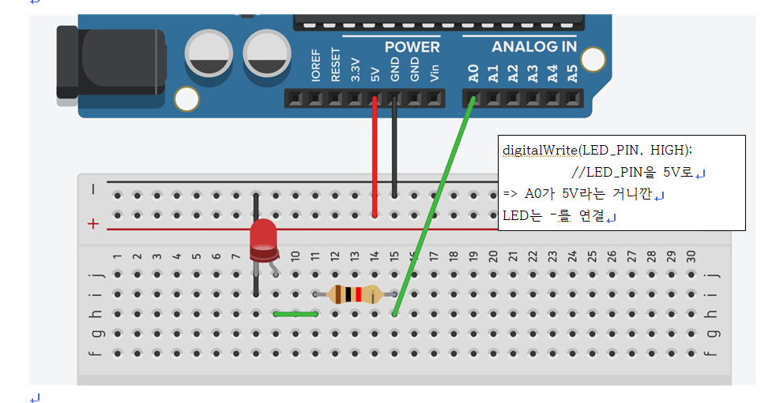
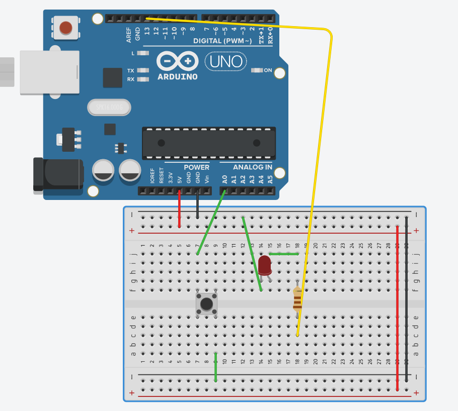

# 아두이노 우노 회로 실습 노트

AI(Claude)에게 원하는 동작을 말로 설명하고, 받은 코드를 직접 회로에 연결해 실습한 기록입니다.
실습은 실제 아두이노 우노 보드와 Tinkercad 시뮬레이터에서 진행했습니다.

- 보드: Arduino Uno R3
- 언어: Arduino 스케치 (C++ 기반)
- 도구: Arduino IDE / arduino-cli, Tinkercad Circuits, Claude Code

---

## 목차

1. [기초 개념 정리](#1-기초-개념-정리)
2. [실습 회로 목록](#2-실습-회로-목록)
3. [디지털 출력: LED 깜빡이기](#3-디지털-출력-led-깜빡이기)
4. [아날로그 입력: 가변저항](#4-아날로그-입력-가변저항)
5. [디지털 입력: 버튼](#5-디지털-입력-버튼)
6. [인터럽트](#6-인터럽트)
7. [아날로그 출력: PWM](#7-아날로그-출력-pwm)
8. [응용: 네오픽셀 게이지](#8-응용-네오픽셀-게이지)
9. [실습하면서 배운 점](#9-실습하면서-배운-점)

---

## 1. 기초 개념 정리

### 스케치 구조

- 아두이노 코드는 **폴더 안에 같은 이름의 `.ino` 파일**로 들어 있어야 한다. (`Blink/Blink.ino`)
- C++ 기반 언어이고, 크게 3구역으로 나뉜다.

| 구역 | 역할 |
|---|---|
| 전역 영역 | 상수·변수 선언 (`const int LED_PIN = 13;`) — setup, loop 모두에서 사용 |
| `setup()` | 전원이 켜질 때 **딱 1번** 실행 (핀 모드 설정, 시리얼 시작) |
| `loop()` | **무한히 반복** 실행 |

### 입력장치 vs 출력장치

가장 먼저 할 일: **이 부품이 입력인지 출력인지, 디지털인지 아날로그인지** 구분하기.

| 입력장치 | 출력장치 |
|---|---|
| 리모컨, 마이크, 버튼, 가변저항, 센서 | 프로젝터, 이어폰, LED, 스피커, 모터 |

### 디지털 vs 아날로그

- **디지털**: 0과 1, 경우의 수 2가지 (1bit) — 켜짐/꺼짐, 눌림/뗌
- **아날로그**: 여러 단계의 값 (2bit 이상) — 밝기, 소리 크기, 센서 값

| 하고 싶은 것 | 구분 |
|---|---|
| LED를 1초마다 껐다 켰다 | 출력 · 디지털 |
| LED를 점점 밝게, 점점 어둡게 | 출력 · 아날로그 |
| 버튼이 눌렸는지 떼졌는지 | 입력 · 디지털 |
| 소음 센서의 소음 값 측정 | 입력 · 아날로그 |

- Boolean: `true / false` = `1 / 0` = `HIGH / LOW`

### GPIO (프로그래밍이 가능한 핀)

아두이노 우노는 OS가 없는 **MCU**이고, GPIO 핀으로 입출력을 제어한다.

| 기능 | 동작 방식 | 사용 가능한 핀 |
|---|---|---|
| 디지털 출력 | 핀을 5V(HIGH) 또는 GND 0V(LOW)로 만든다 | 0~13, A0~A5 |
| 디지털 입력 | 핀의 전압이 5V에 가까운지 0V에 가까운지 판단해 1/0 | 0~13, A0~A5 |
| 아날로그 출력 | **PWM**(펄스 폭 변조)으로 아날로그 값을 흉내 낸다 | `~` 표시 핀: 3, 5, 6, 9, 10, 11 |
| 아날로그 입력 | 핀의 전압을 **0~1023 (10bit)** 값으로 읽는다 | A0~A5 |

### 시리얼 통신

- USB로 내 컴퓨터와 아두이노가 통신하는 기능 → **시리얼 모니터**로 값 확인
- `Serial.begin(9600)` — 보내는 속도와 받는 속도가 같아야 한다. (9600, 115200을 많이 씀)

### arduino-cli + AI로 업로드하기

AI 에이전트에게 이렇게 요청해서 업로드했다.

> arduino-cli를 이용해서 COM5 포트(장치 관리자 → 포트)에 연결된 아두이노 우노의 Blink 코드를 0.1초 간격으로 올려줘

**Blink를 가장 먼저 올리는 이유**
- 가장 기초 코드이고 회로가 필요 없다. (보드 내장 LED 사용)
- 보드가 정상인지, USB 연결이 정상인지, arduino-cli와 에이전트가 정상인지 한 번에 확인할 수 있다. (프로그래밍의 `print("hello")` 같은 역할)

---

## 2. 실습 회로 목록

| # | 폴더 | 회로 | 배운 개념 |
|---|---|---|---|
| 1 | [`Blink`](Blink/Blink.ino) | A0 LED 1개 | 디지털 출력 |
| 2 | [`Blink_D3`](Blink_D3/Blink_D3.ino) | 3번 핀 LED 1개 | 디지털 출력 |
| 3 | [`Blink_3LED`](Blink_3LED/Blink_3LED.ino) | A0, A2, A4 LED 3개 | 디지털 출력 여러 개 |
| 4 | [`Potentiometer_A5`](Potentiometer_A5/Potentiometer_A5.ino) | 가변저항 2개 (A5, A4) | 아날로그 입력, 시리얼 |
| 5 | [`Button_A0`](Button_A0/Button_A0.ino) | A0 버튼 + 13번 LED | 디지털 입력, 내부 풀업 |
| 6 | [`button_led`](button_led/button_led.ino) | 2번 버튼 + 13번 LED | 디지털 입력 |
| 7 | [`Button_Count`](Button_Count/Button_Count.ino) | A0 버튼 + A5 LED | 디바운싱, 상태변화 감지 |
| 8 | [`Button_Gesture`](Button_Gesture/Button_Gesture.ino) | A0 버튼 + A5 LED | 더블클릭 / 길게 누르기 |
| 9 | [`Button_Interrupt`](Button_Interrupt/Button_Interrupt.ino) | 2번 버튼 + A5 LED | 인터럽트 |
| 10 | [`traffic_interrupt`](traffic_interrupt/traffic_interrupt.ino) | 신호등 LED 3개 + 2번 버튼 | 인터럽트, 풀다운 회로 |
| 11 | [`fade_led`](fade_led/fade_led.ino) | 11번 LED | PWM 아날로그 출력 |
| 12 | [`pot_led`](pot_led/pot_led.ino) | 가변저항(A0) + 11번 LED | 아날로그 입력 → 출력 |
| 13 | [`pot_neopixel_gauge`](pot_neopixel_gauge/pot_neopixel_gauge.ino) | 가변저항(A0) + 네오픽셀 8구 | 라이브러리, 게이지 표현 |

> 모든 LED는 **핀 → 저항(220Ω) → LED 긴 다리(+) → LED 짧은 다리(−) → GND** 로 연결했다.

---

## 3. 디지털 출력: LED 깜빡이기

### 3-1. Blink — A0 LED 1초 깜빡이기



```
A0 ── 220Ω ── LED(+) ── LED(−) ── GND
```

- `pinMode(A0, OUTPUT)` → `digitalWrite(HIGH/LOW)` + `delay(1000)`
- A0~A5도 **디지털 출력**으로 쓸 수 있다는 것을 확인
- `digitalWrite(LED_PIN, HIGH);` → A0가 **5V**가 된다는 뜻이니까, LED의 다른 쪽(−)은 **GND**에 연결해야 전류가 흐른다

### 3-2. Blink_D3 — 3번 핀 LED

```
D3 ── 220Ω ── LED ── GND
```

- 같은 코드에서 핀 번호만 디지털 핀(3번)으로 바꿔본 실습

### 3-3. Blink_3LED — LED 3개 번갈아 켜기

| LED | 핀 |
|---|---|
| LED1 | A0 |
| LED2 | A2 |
| LED3 | A4 |

- 1초마다 하나씩만 켜지도록 HIGH/LOW를 조합
- 핀 번호를 `const int`로 선언해서 나중에 바꾸기 쉽게 함

---

## 4. 아날로그 입력: 가변저항

### Potentiometer_A5 — 가변저항 2개 값 읽기

```
가변저항 양쪽 다리: 5V, GND
가변저항 가운데 다리 ── A5 (가변저항1)
                     ── A4 (가변저항2)
```

- `analogRead()` → **0~1023** 값
- 전압으로 바꾸기: `value * 5.0 / 1023.0`
- 가변저항을 돌리면 저항값이 바뀌고 → **전압 분배**가 일어나서 → 가운데 다리의 전압이 바뀐다
- 결과는 시리얼 모니터로 확인

---

## 5. 디지털 입력: 버튼

### 버튼에서 꼭 알아야 할 3가지

1. **풀업 / 풀다운 저항 회로**가 반드시 필요하다. (없으면 값이 떠서 불안정)
2. **채터링** — 실제 버튼은 누르는 순간 접점이 떨려서 여러 번 눌린 것처럼 읽힌다.
   → **디바운싱**: 커패시터를 달거나, 처음 약 0.05초는 무시하는 코드를 쓴다.
3. **상태변화 감지** — "누르고 있는 중"이 아니라 "누르는 순간"을 알려면
   → `millis()`로 **현재값과 과거값을 비교**하거나, **인터럽트**를 쓴다.

### 풀업 vs 풀다운 (실습하면서 직접 겪은 부분)

| 방식 | 배선 | 뗐을 때 | 눌렀을 때 | 코드 |
|---|---|---|---|---|
| 내부 풀업 | 핀 ── 버튼 ── GND (저항 없음) | HIGH | **LOW** | `INPUT_PULLUP` |
| 외부 풀업 | 5V ── 저항 ── 핀 ── 버튼 ── GND | HIGH | **LOW** | `INPUT` |
| 외부 풀다운 | 5V ── 버튼 ── 핀 ── 저항 ── GND | LOW | **HIGH** | `INPUT` |

> 배선 방식과 코드가 서로 맞지 않으면 **버튼 동작이 반대로** 나온다.
> (신호등 실습에서 "누르면 신호등, 떼면 전부 켜짐"으로 반대로 동작했던 원인)
> 인터럽트를 쓰든 안 쓰든 **배선은 똑같고**, 눌림이 HIGH인지 LOW인지만 코드에 맞추면 된다.

### 5-1. Button_A0 — 버튼 누르면 LED 켜기 (Tinkercad)



```
A0 ── 버튼 ── GND          (내부 풀업, 저항 없음)
D13 ── 220Ω ── LED ── GND
```

- 누르고 있으면 LED ON, 떼면 OFF
- 버튼은 **대각선 다리**에 연결 → 버튼 방향과 상관없이 누를 때만 연결된다
- 시리얼 모니터에 `Button pressed / Button released` 출력

### 5-2. button_led — 2번 핀 버튼으로 LED 켜기

```
D2 ── 버튼 ── GND          (내부 풀업)
D13 ── 220Ω ── LED ── GND
```

### 5-3. Button_Count — 누른 횟수 세기

```
A0 ── 버튼 ── GND
A5 ── 220Ω ── LED ── GND
```

- `millis()` 디바운싱(50ms) + 현재값/과거값 비교로 **누르는 순간만** 카운트
- 5번 누를 때마다 LED 토글

### 5-4. Button_Gesture — 더블클릭 / 길게 누르기

회로는 Button_Count와 같음.

| 동작 | 결과 |
|---|---|
| 따닥 (400ms 안에 2번) | LED ON |
| 길게 누르기 (1초 이상) | LED OFF |
| 한 번 짧게 | 아무 일도 안 함 |

- 버튼 하나로 여러 명령을 구분하는 방법 — 시간(`millis()`)을 재서 판단

---

## 6. 인터럽트

- 우노에서 `attachInterrupt()`를 쓸 수 있는 핀은 **2번, 3번뿐**
- 인터럽트 함수(ISR) 안에서 바꾸는 변수에는 **`volatile`**
- ISR 안에서는 `Serial`, `delay()`를 쓰지 않는다 → 깃발 변수만 세우고 `loop()`에서 처리
- 트리거 종류: `FALLING`(HIGH→LOW), `RISING`(LOW→HIGH), `CHANGE`(둘 다)

### 6-1. Button_Interrupt — 누를 때·뗄 때마다 LED 토글

```
D2 ── 버튼 ── GND          (내부 풀업)
A5 ── 220Ω ── LED ── GND
```

### 6-2. traffic_interrupt — 신호등 + 비상 버튼

```
D7 ── 220Ω ── 빨강 LED ── GND
D8 ── 220Ω ── 노랑 LED ── GND
D9 ── 220Ω ── 초록 LED ── GND
5V ── 버튼 ── D2 ── 10kΩ ── GND   (외부 풀다운)
```

- 평소: 빨강(3초) → 노랑(1초) → 초록(3초) 반복
- 버튼을 **누르고 있는 동안** LED 3개 모두 즉시 ON, **떼면** 신호등 다시 시작
- `delay()`를 쓰면 기다리는 동안 반응을 못 하므로, `millis()`로 기다리면서 버튼을 확인하는 `waitOrPressed()` 함수를 만듦
- 코드 위의 `BUTTON_TO_GND` 값으로 풀업/풀다운 배선을 선택

**AI와 수정한 과정**
1. 처음: 버튼을 누를 때마다 전부 켜짐 ↔ 신호등 토글 → 원하던 동작이 아니었음
2. "누르고 있으면 전부 켜짐, 떼면 신호등"으로 수정 (`CHANGE` 인터럽트)
3. 실제로는 **반대로** 동작 → 회로도 사진을 보여주고 원인 분석
   → 내 회로가 **풀다운** 방식이었는데 코드는 풀업 기준이었음 → 설정 변경으로 해결

---

## 7. 아날로그 출력: PWM

- `~` 표시가 있는 핀만 가능: **3, 5, 6, 9, 10, 11**
- `analogWrite(핀, 0~255)` — 0은 꺼짐, 255는 최대 밝기
- 실제로는 아주 빠르게 켜졌다 꺼졌다 하면서 켜져 있는 시간 비율(펄스 폭)로 밝기를 표현

### 7-1. fade_led — 점점 밝아졌다 어두워지기

```
D11(~) ── 220Ω ── LED ── GND
```

- `for`문으로 0→255, 255→0 반복, 한 단계에 10ms

### 7-2. pot_led — 가변저항으로 LED 밝기 조절

```
가변저항 양쪽: 5V, GND / 가운데 ── A0
D11(~) ── 220Ω ── LED ── GND
```

- **아날로그 입력(0~1023)** → `map()` → **아날로그 출력(0~255)**
- `map(potValue, 0, 1023, 0, 255)` (= `potValue / 4`)

---

## 8. 응용: 네오픽셀 게이지

### pot_neopixel_gauge — 가변저항으로 게이지 채우기

```
네오픽셀 8구: DIN ── D10, 5V ── 5V, GND ── GND
가변저항 양쪽: 5V, GND / 가운데 ── A0
```

- 라이브러리: **Adafruit NeoPixel**
- 가변저항 값에 따라 0~8개 LED 켜기
- 색이 초록 → 노랑 → 빨강으로 변하는 게이지
- `map(…, 0, 8)`을 쓰면 1023일 때만 8칸이 되므로 `value * 9 / 1024`로 구간을 고르게 나눔
- `strip.show()`를 호출해야 실제로 반영됨

---

## 9. 실습하면서 배운 점

- **부품을 보면 먼저 입력/출력, 디지털/아날로그부터 구분**하면 쓸 함수가 정해진다.
  - 디지털 출력 `digitalWrite` / 디지털 입력 `digitalRead`
  - 아날로그 출력 `analogWrite` (PWM 핀) / 아날로그 입력 `analogRead` (A0~A5)
- 버튼은 생각보다 어렵다: **풀업·풀다운, 채터링, 상태변화** 3가지를 항상 챙겨야 한다.
- **회로와 코드는 한 세트**다. AI가 준 코드가 맞아도 내 회로의 배선 방식과 다르면 반대로 동작한다.
  → AI에게 회로도 사진을 함께 보여주니 원인을 정확히 찾을 수 있었다.
- AI에게 요청할 때는 **핀 번호, 원하는 동작(누르고 있을 때 / 뗄 때)** 을 구체적으로 말할수록 한 번에 원하는 코드를 받을 수 있었다.
- `delay()`는 그동안 아무것도 못 하게 막는다. 반응이 필요하면 `millis()`나 인터럽트를 쓴다.
